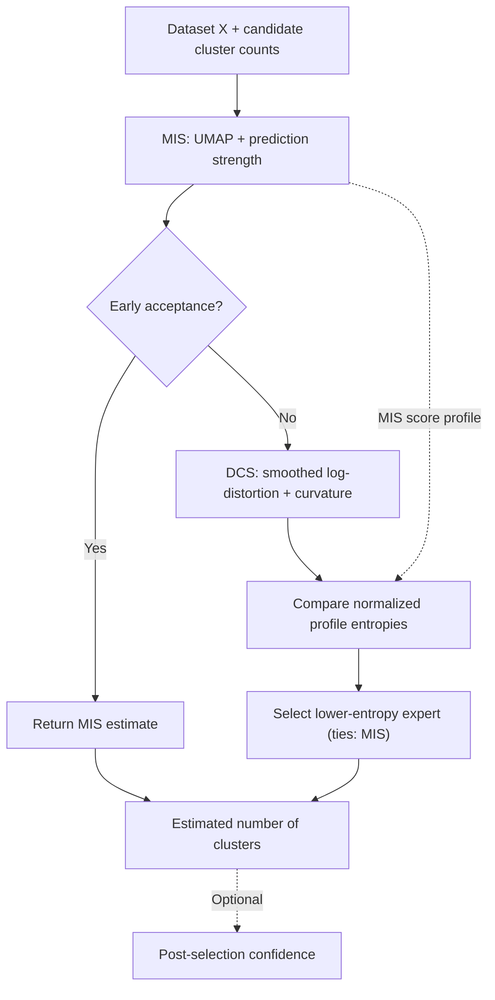

# MED — Manifold Entropy Dispatching

**Adaptive cluster-number estimation with manifold-informed stability, distortion curvature, and entropy-guided expert selection.**

[](https://www.python.org/)
[](https://github.com/Yang233666/MED/stargazers)

**Authors:** Yang Yang · Edward Curry  
**Affiliation:** Rinn Artificial Intelligence, Institute for Data and AI Research, University of Galway  
**Code:** [`code/MED_method.py`](code/MED_method.py) · **Data:** [`data/real_dataset/`](data/real_dataset/)

## Overview

Determining the number of clusters is a fundamental challenge in unsupervised pattern recognition. Different estimation criteria capture different aspects of data structure, and their performance can vary substantially across datasets.

**MED (Manifold Entropy Dispatching)** addresses this challenge by combining two complementary cluster-number estimators with an adaptive, information-theoretic selection mechanism:

| Component | Key idea |
| --- | --- |
| **MIS — Manifold-Informed Stability** | Evaluates five-fold prediction strength after learning a low-dimensional UMAP representation. |
| **DCS — Distortion Curvature Stability** | Measures slope-normalized curvature in a smoothed log-distortion profile. |
| **MED — Manifold Entropy Dispatching** | Uses score-profile concentration to select between MIS and DCS, with early acceptance to avoid unnecessary DCS evaluations. |

MED combines **manifold geometry**, **clustering stability**, and **distortion analysis** in a single adaptive framework.

## How MED works

1. **MIS** standardizes the features, learns a manifold embedding, and evaluates prediction strength across candidate cluster counts. It selects the largest candidate with prediction strength strictly greater than 0.8, or the first score maximizer when none passes the threshold.
2. **Early acceptance** transforms MIS scores with raw-score softmax. If the top-two probability margin exceeds the population standard deviation of those probabilities, MED returns the MIS estimate immediately.
3. **DCS** runs when early acceptance is not triggered. It computes log-distortion, applies Savitzky–Golay smoothing, and uses two numerical gradients to construct a signed, slope-normalized curvature profile over the supplied candidate grid.
4. **Entropy-guided dispatching** compares the normalized entropies of the two raw-score softmax distributions. MED chooses DCS if its entropy is lower and MIS otherwise.
5. **Optional confidence estimation** assesses internal support after the estimate is selected; it does not change the routing decision.



## Results

The accompanying manuscript evaluates MED on **11 benchmark datasets against 28 comparison methods**, together with additional open-knowledge-base embedding and language-model experiments.

| Method | Average relative error (ARE ↓) | Exact matches (EM ↑) |
| --- | ---: | ---: |
| **MED** | **0.128** | **6 / 11** |
| Log-Jump | 0.246 | 3 / 11 |

These are the **results reported in the manuscript's benchmark table**. The reported ARE of MED is approximately **48% lower** than that of Log-Jump. In the early-acceptance ablation, MED invokes DCS on **6 of 11 datasets**, compared with 11 of 11 when early acceptance is disabled, while retaining the same final estimates.

## Installation

Clone the repository and install the dependencies used by the available Python scripts:

```bash
git clone https://github.com/Yang233666/MED.git
cd MED

python -m pip install numpy scipy scikit-learn umap-learn tqdm kneed pandas matplotlib
```

A virtual environment is recommended. The repository does not currently provide a pinned dependency lockfile.

## Quick start

The following example calls the public `MED_Method` interface on the Iris dataset, using the benchmark-style upper bound for candidate cluster counts:

```python
import sys
from pathlib import Path

import numpy as np
from sklearn.datasets import load_iris

sys.path.insert(0, str(Path("code").resolve()))
from MED_method import MED_Method

X = load_iris().data
max_k = int(np.floor(np.sqrt(X.shape[0]) / 2))

model = MED_Method(X, random_state=0)
estimated_k = model.find_optimal_k(max_k=max_k)

print(f"Estimated number of clusters: {estimated_k}")
```

To obtain the optional confidence estimate, use `MED_Method_confidence` instead:

```python
from MED_method import MED_Method_confidence

model = MED_Method_confidence(X, random_state=0)
estimated_k = model.find_optimal_k(max_k=max_k)
print(f"Estimated k: {estimated_k}, confidence: {model.confidence_:.3f}")
```

Run these snippets from the repository root so the `code/` import path resolves correctly.

## Repository structure

```text
MED/
├── code/
│   ├── MED_method.py
│   ├── Test_on_real_datasets.py
│   └── Test_on_real_datasets_with_confidence.py
└── data/
    └── real_dataset/
        ├── Colon Cancer/
        ├── Prostate Cancer/
        ├── echocardiogram.data
        ├── seeds_dataset.txt
        └── ... other provided datasets
```

- **`MED_method.py`** implements MIS, DCS, MED, and the confidence-enabled MED variant.
- **`Test_on_real_datasets.py`** contains the historical benchmark data loaders and evaluation driver.
- **`Test_on_real_datasets_with_confidence.py`** evaluates expert selections, confidence, and related summaries and plots.
- **`data/real_dataset/`** contains locally stored benchmark input files. Other datasets are loaded through `scikit-learn` / OpenML by the evaluation scripts.

**Evaluation note:** The historical scripts use dataset paths relative to their original execution working directory. Adjust `base_data_path` / `DATA_DIR` to your local checkout before running those drivers. The repository currently provides the core implementations and selected dataset assets; the full set of baseline, OKB, and LLM experiment artifacts is not included here.

## Research paper and citation

This repository accompanies the manuscript:

> **Adaptive cluster number estimation via manifold entropy dispatching**  
> Yang Yang and Edward Curry

Publication and citation details will be added when available. If you use the code in research, please reference this repository and the associated manuscript.

## Acknowledgements

This publication has emanated from research conducted with the financial support of Taighde Éireann – Research Ireland, under Grant number [23/RC/13506] at Rinn Artificial Intelligence.

## Contact

For research questions and feedback, contact **Yang Yang** at [yang.yang@insight-centre.org](mailto:yang.yang@insight-centre.org), or open a [GitHub issue](https://github.com/Yang233666/MED/issues).
